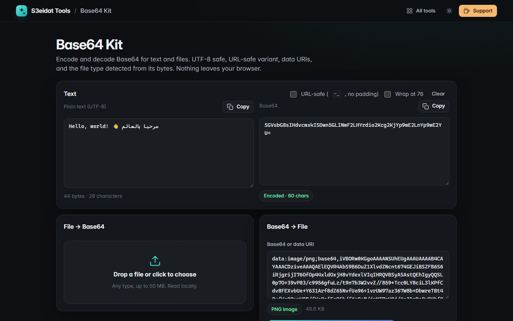

# Base64 Kit

> Encode and decode Base64 text and files. Free, private, and it runs entirely in your browser.

### ▶ [Open Base64 Kit](https://s3eidat.github.io/base64-kit/)



## Features

- **Text ⇄ Base64** live in both directions, **UTF-8 safe** (Arabic, emoji, any script)
- **URL-safe** variant (`-` and `_`, no padding) and optional wrapping at 76 characters
- Lenient decoding: accepts URL-safe input, missing padding, line breaks and `data:` URIs
- **File → Base64** or a ready-to-paste **data URI**, with image preview, copy and download
- **Base64 → file**: the real file type is detected from its magic bytes (PNG, JPEG, GIF, WebP, BMP,
  PDF, ZIP, Gzip, MP3, Ogg, MP4, WOFF2, SVG, JSON/text) and the download gets the right extension
- Clear errors for invalid characters or a wrong length

## Privacy

Your text and files never leave your device. There is no server, no account, no analytics.
The page ships with a strict Content-Security-Policy (`connect-src 'self'`), so the browser
itself blocks any attempt to send data anywhere.

## Run it yourself

It's plain HTML, CSS and JavaScript with no build step:

```bash
git clone https://github.com/s3eidat/base64-kit
cd base64-kit
python -m http.server 8000
```

Then open http://localhost:8000.

## Support

If this saved you time, **[buy me a coffee ☕](https://s3eidat.github.io/coffee/)**. It keeps every tool free.

---

Part of **[S3eidat Tools](https://s3eidat.github.io/)**: 100+ free, private tools that run in your browser. MIT licensed.
